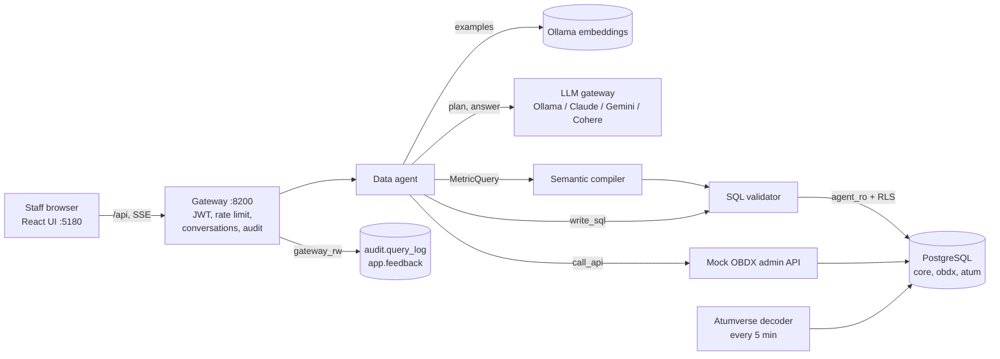

# Bank Conversational AI

One conversational AI platform for the bank: data, log and document assistants for
staff, and a banking assistant for customers, on a shared core. The first build is the
**Bank Data Agent**. Start with [docs/DESIGN.md](docs/DESIGN.md), then
[docs/specs/data-agent.md](docs/specs/data-agent.md). Rules for Claude Code are in
[CLAUDE.md](CLAUDE.md), and deviations from the design are in [docs/adr/](docs/adr/).

**Developer handbook:** [docs/HANDBOOK.md](docs/HANDBOOK.md) covers installation on every OS (including Ollama), configuration and LLM modes, deployment, the data model, extending the agent, the API, testing, troubleshooting and connecting the real FLEXCUBE, OBDX and Atumverse systems. It is also in the staff portal: log in and click **Handbook** (downloads: Markdown, HTML, PDF).

## Status

| Data-agent phase | State |
|---|---|
| 1. Data: schema, agent_ro + RLS, seeder, sanity checks | done |
| 2. Semantic layer, compiler, validator, Atumverse decoder | done |
| 3. Agent + LLM adapters (Ollama default) | done |
| 4. Gateway + React UI | done |
| 5. Golden-set evaluation | done, awaiting review |

## Architecture



Run the whole thing:

```bash
make up && make seed            # database (once)
make api                         # gateway on :8200 (terminal 1)
make web                         # UI on http://localhost:5180 (terminal 2)
# or everything in Docker:  make up-all   (Ollama stays on the host)
```

## Demo script (10 questions)

Log in as **Head Office MIS Analyst** unless noted.

1. *Accounts opened by branch last quarter* → bar chart, definition, SQL.
2. *Accounts opened digitally vs in branch this year* → cross-schema join (OBDX ↔ core).
3. *Now only for Salmiya* → follow-up reuses the previous query.
4. *Mobile vs web transaction value by month* → line chart with two series.
5. *كم عدد الحسابات الجديدة هذا الشهر؟* → Arabic, right-to-left, KPI tile.
6. *How many accounts were opened?* → clarification buttons for the period.
7. *Active sessions right now* → live OBDX API, not SQL (run `make refresh-live` first).
8. *Which stage breaches SLA most often?* → Atumverse workflow metric, ranked.
9. *List customer names with balance above 10,000* → refused: personal data.
10. Log in as **Salmiya Branch Manager**: *Accounts opened in all branches last month* →
    only Salmiya, and the answer says so.

## Quick start

Requires Docker and [uv](https://docs.astral.sh/uv/).

```bash
cp .env.example .env
uv sync --python 3.12
make up        # Postgres 16 on localhost:5544
make seed      # ~25 s: schemas, synthetic data, agent_ro grants + RLS, Atumverse decode
make sanity    # row counts and data quirks vs spec targets
make test      # unit + DB security tests
make lint      # ruff + mypy
make cov       # tests + coverage gate (>= 85% on the semantic package)
make decode    # re-run the Atumverse decoder (incremental)
make refresh-live            # before a demo: 50-150 sessions "active right now" (lasts ~15 min)
make refresh-live COUNT=120  # exact number
```

### Local LLM (Ollama, the default provider)

```bash
brew install ollama
# Start the server with the 8-bit KV cache (halves its memory) and keep it running:
OLLAMA_FLASH_ATTENTION=1 OLLAMA_KV_CACHE_TYPE=q8_0 ollama serve
#   or as a login service: launchctl setenv OLLAMA_KV_CACHE_TYPE q8_0 && brew services start ollama
make ollama-model   # pulls qwen3:8b + qwen3-embedding:0.6b, builds bcai-qwen3-8b (8k context)
```

Keep `OLLAMA_THINK=false`: with thinking on, qwen3 takes about 30 s per planner call
instead of about 7 s. The planner prompt is about 4k tokens, more than Ollama's default
4k context, hence the `bcai-qwen3-8b` model from `infra/ollama/Modelfile`. Local runs are
for development; quote accuracy and latency only from a hosted-model run.

### Ask the data agent

```bash
make ask Q="How many accounts were opened last quarter by branch?"
make ask Q="كم عدد الحسابات الجديدة هذا الشهر؟" USER=bm_salmiya
uv run --python 3.12 python -m assistants.data.cli --user rh_north   # conversation
uv run --python 3.12 python -m assistants.data.cli "..." --json      # raw SSE-style events
make test-live      # a few real Ollama calls (slow; excluded from make test)
```

Switch provider with `LLM_PROVIDER=anthropic|gemini|cohere|ollama` in `.env` (plus that
provider's key and model); no code changes.

## Layout

```
aiplatform/   shared platform: gateway, llm, tools, guardrails, audit, eval (ADR-0001)
assistants/   data/ (first), later logs/, docs/, banking/
mocks/        seed/ synthetic data generator; obdx/ mock admin APIs (phase 3)
infra/        docker-compose.yml; db/ DDL, indexes, roles and RLS
web/staff/    staff chat UI (phase 4)
docs/         DESIGN.md, specs/, adr/
```

## Database

| Schema | Content | agent_ro access |
|---|---|---|
| core | branches, customers, accounts, transactions | SELECT; no `full_name`, `national_id`, `mobile_no` |
| obdx | digital users, sessions, origination applications | SELECT |
| atum | Atumverse workflows, stages, history, documents, decoded flat table | SELECT; no payload, document BLOB or OCR columns; no `decode_error` |
| app | staff users for mock SSO | none |
| audit | append-only query log | none |

Row-level security filters every branch-bearing table by
`current_setting('app.user_branches')`, which the gateway sets per request with
`SET LOCAL`. If it is unset, no rows are returned.

Demo users: `bm_salmiya` (branch 001), `rh_north` (005–008), `ho_analyst` (all),
`it_ops` (live APIs only).

## Semantic layer (`assistants/data/semantic/`)

| File | Role |
|---|---|
| `model.yaml` | Entities, joins, dimensions, code lookups, row security, and the allowlist the validator enforces |
| `metrics/*.yaml` | One file per metric (21): measure, time dimension, default filters, dimensions, synonyms |
| `examples.yaml` | Verified question → MetricQuery pairs (English and Arabic) for the planner's few-shot prompt |
| `atum_fields.yaml` | Atumverse payload field map per workflow and payload version |
| `query.py` | `MetricQuery`: the planner's tool schema |
| `periods.py` | Period resolver (bank time zone, calendar quarters, Sunday-start weeks) |
| `compiler.py` | MetricQuery → sqlglot tree → SQL with bind parameters and the row-security predicate |
| `validator.py` | Allowlist, function and structure checks, row-security wrapper for free SQL, LIMIT 500 |
| `atum_decoder.py` | Decodes JSON, gzip BLOB and raw-text payloads into `atum.wf_instance_flat` |

### Adding a metric

1. Add `assistants/data/semantic/metrics/<name>.yaml` (copy a similar one). Use only
   dimensions declared on the entity in `model.yaml`.
2. Add 1–3 verified examples to `examples.yaml`.
3. Run `make test`: the loader rejects unknown dimensions, unallowlisted columns and
   blocked columns, and every example is compiled, validated and executed.

No Python changes are needed unless the compiler can't express the measure.

## Data agent (`assistants/data/agent/`)

One request runs: retrieve similar examples (Ollama embeddings) → planner LLM picks one
tool → code compiles, validates and runs it as `agent_ro` (or calls the OBDX mock API) →
answer LLM writes 1–3 sentences → grounding check (every number must come from the
result, else a templated answer) → one `audit.query_log` row. An invalid tool call is fed
back to the planner once. Security rejections are refused without a retry.

| File | Role |
|---|---|
| `agent.py` | Orchestration and the SSE event stream (`status, plan, clarify, result, chart, answer_delta, definition, sql, done, error`) |
| `tools.py` | The five tools, typed args, and the role gate (`it_support`: live APIs only) |
| `prompts.py` | Planner and answerer prompts (no vendor forks) |
| `examples_index.py` | Few-shot example retrieval: embeddings, disk cache, word-overlap fallback |
| `charts.py` | Chart type in code: KPI / line / bar / table |
| `obdx_client.py` | Live OBDX admin APIs (mock in-process via ASGI, or `OBDX_ADMIN_URL`) |

Platform pieces used here live in `aiplatform/`: `llm/` (provider adapters),
`tools/registry.py`, `guardrails/` (grounding check, PII masking for hosted providers),
`audit/writer.py`, `gateway/auth.py` (`AuthContext`).

## Evaluation (golden set)

`assistants/data/eval/golden.yaml` holds 48 questions (30 English, 18 Arabic), covering
every route and 9 security cases (PII, prompt injection, cross-branch access, write
statements, role gate). Each case names who asks, the expected route, how it is checked,
and, where results matter, hand-written reference SQL that runs as `agent_ro` with that
user's branches.

```bash
make eval PROVIDER=ollama               # or anthropic | gemini | cohere | all
make eval PROVIDER=ollama IDS=E01,A14   # a subset
```

The report goes to `assistants/data/eval/reports/report.md` (plus a JSON file per run). It
shows accuracy per path, English vs Arabic, the security pass rate, p50/p95 latency,
tokens and cost (set prices in `aiplatform/eval/prices.yaml`). `make test` checks the
golden set itself without an LLM: every expected query must reproduce its reference SQL,
so a failed case means the planner chose wrongly, not that the yardstick is wrong.
